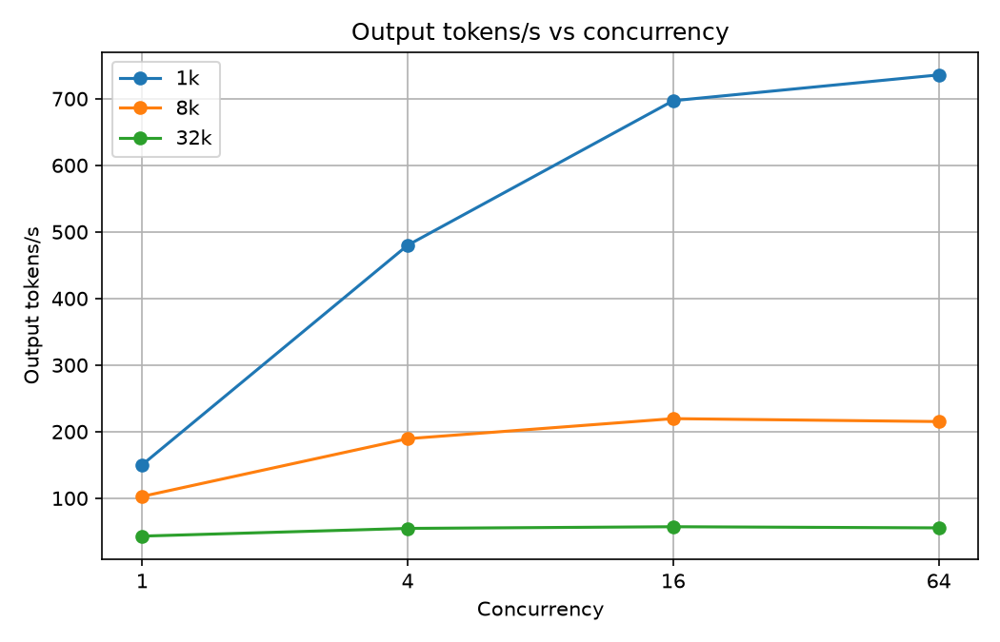
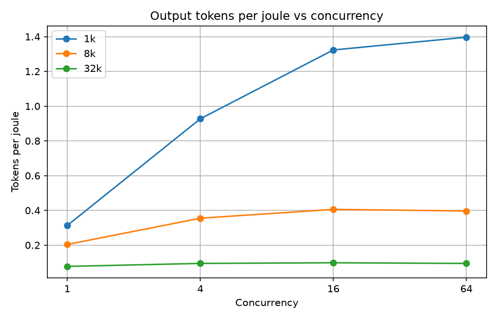

# Serving capacity and power sweep, 2026-11-04

**What was run:** `vllm bench serve` (from the vLLM 0.30 brain container `qwen38-nvfp4-tp2`) against Qwen/Qwen3.8-27B NVFP4 on two RTX 5090s (TP2, MTP speculative decoding on), at http://127.0.0.1:8000. The matrix was concurrency {1, 4, 16, 64} x prompt length {1k, 8k, 32k} tokens. Each request asked for 256 output tokens (`--ignore-eos`) with random-token prompts at temperature 0. Each cell sent 20 requests, except the concurrency-64 cells, which sent 64. While each cell ran, `nvidia-smi` logged both GPUs every 500 ms. Watts are the sum of both GPUs, counted only over the benchmark's own measured window. Tokens per joule = output tokens / (mean watts x duration).

**To reproduce:**

```
cd ${BENCH_DIR}
bash sweep.sh                       # full matrix, about 25 min
TAG=rerun bash sweep.sh 4 8192      # one cell, tagged so it does not overwrite
python3 summarize.py
```

## Results

| Prompt | Conc | Reqs | TTFT p50 ms | TTFT p95 ms | TPOT p50 ms | TPOT p95 ms | Out tok/s | Req/s | Mean W | Peak W | Tok/J |
|---|---|---|---|---|---|---|---|---|---|---|---|
| 1k | 1 | 20/20 | 140 | 140 | 5.8 | 7.6 | 150.3 | 0.59 | 480 | 483 | 0.313 |
| 1k | 4 | 20/20 | 168 | 481 | 7.3 | 8.3 | 480.0 | 1.88 | 518 | 524 | 0.927 |
| 1k | 16 | 20/20 | 2725 | 3513 | 8.8 | 10.8 | 697.1 | 2.72 | 527 | 548 | 1.323 |
| 1k | 64 | 64/64 | 10048 | 19324 | 9.6 | 11.9 | 735.8 | 2.87 | 527 | 538 | 1.397 |
| 8k | 1 | 20/20 | 1027 | 1038 | 5.8 | 6.6 | 102.7 | 0.40 | 504 | 538 | 0.204 |
| 8k | 4 | 20/20 | 1132 | 2933 | 15.7 | 18.5 | 189.5 | 0.74 | 534 | 557 | 0.355 |
| 8k | 16 | 20/20 | 10770 | 15573 | 25.4 | 37.6 | 219.6 | 0.86 | 541 | 561 | 0.406 |
| 8k | 64 | 64/64 | 37208 | 70539 | 30.8 | 39.8 | 215.2 | 0.84 | 543 | 562 | 0.396 |
| 32k | 1 | 20/20 | 4516 | 4533 | 5.9 | 7.5 | 43.2 | 0.17 | 556 | 601 | 0.078 |
| 32k | 4 | 20/20 | 5252 | 10751 | 54.8 | 77.7 | 54.7 | 0.21 | 577 | 599 | 0.095 |
| 32k | 16 | 20/20 | 41936 | 64382 | 107.5 | 149.2 | 57.3 | 0.22 | 581 | 599 | 0.099 |
| 32k | 64 | 64/64 | 146645 | 279596 | 110.7 | 177.9 | 55.5 | 0.22 | 586 | 606 | 0.095 |





## Verification

- **Smoke cell (c1, 1k):** TTFT p50 139 ms; 150 tok/s single stream. That is above the expected 60-100 because MTP speculative decoding accepted about 2.75 tokens per step (ITL is 16.7 ms, about 60 steps/s). Random-token prompts with forced length give high draft acceptance, so real chat traffic will decode slower than these numbers.
- **Rerun of c4-in8192** (fresh seed): output tok/s 189.5 vs 189.3 (-0.1%), mean W 533.9 vs 534.5 (+0.1%), tok/J 0.355 vs 0.354 (-0.2%), TPOT p50 15.7 vs 13.9 ms (-11%). TTFT p50 moved from 1132 to 1909 ms (+69%). With 4 streams, TTFT depends on whether a request queues behind another request's 8k prefill, so p50 over 20 requests is noisy. Throughput and power reproduce; TTFT at this sample size does not.
- **Spot check:** the c16-in8192 row in `results/cells.csv` (219.6 tok/s, 0.406 tok/J) matches the orange point at x=16 on both charts. Its mean watts (541.06 W over 47 samples) were recomputed independently from the raw `c16-in8192-gpu.csv` and matched exactly.
- **First full run discarded:** it is kept in `results/run1-seed42-contaminated/`. Every cell used seed 42, so later cells of the same prompt length hit vLLM's prefix cache (c4-in8192 TTFT 250 ms vs c1 1030 ms). The concurrency-64 cells sent only 5 requests, so they peaked at 5 concurrent. The scripts now use a seed per cell and 64 requests at concurrency 64; the bench logs show "Peak concurrent requests: 64.00".

The scripts were written by the Qwen3.8-27B model running on this machine, through 6 prompt rounds; the operator scoped, reviewed, ran and verified them; raw outputs are in results/. The prompt rounds were 4 for sweep.sh and 2 for summarize.py, and the full prompts and replies are in `model-transcript.md`.
